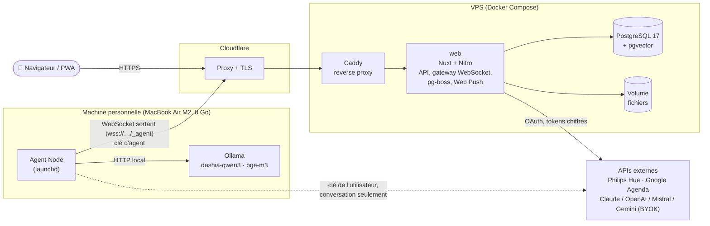
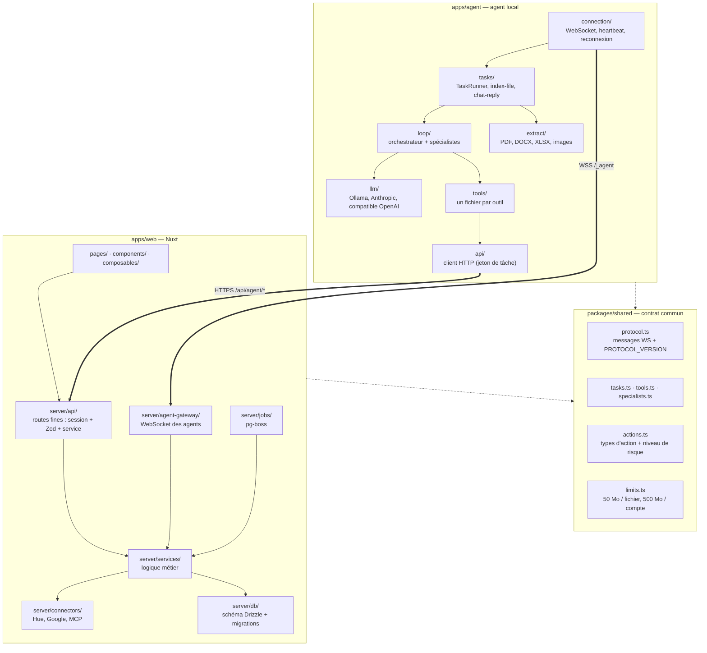
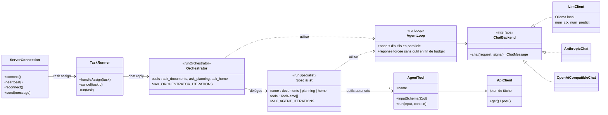
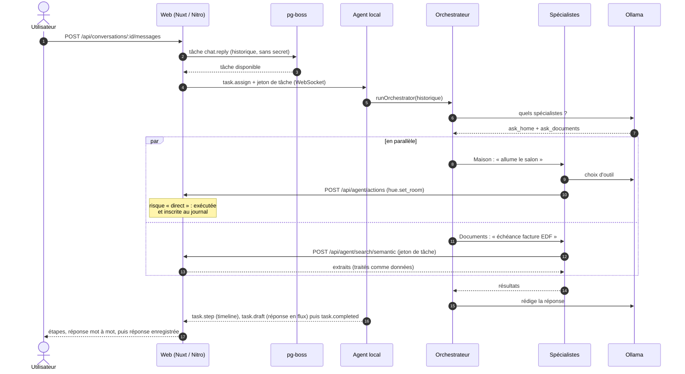
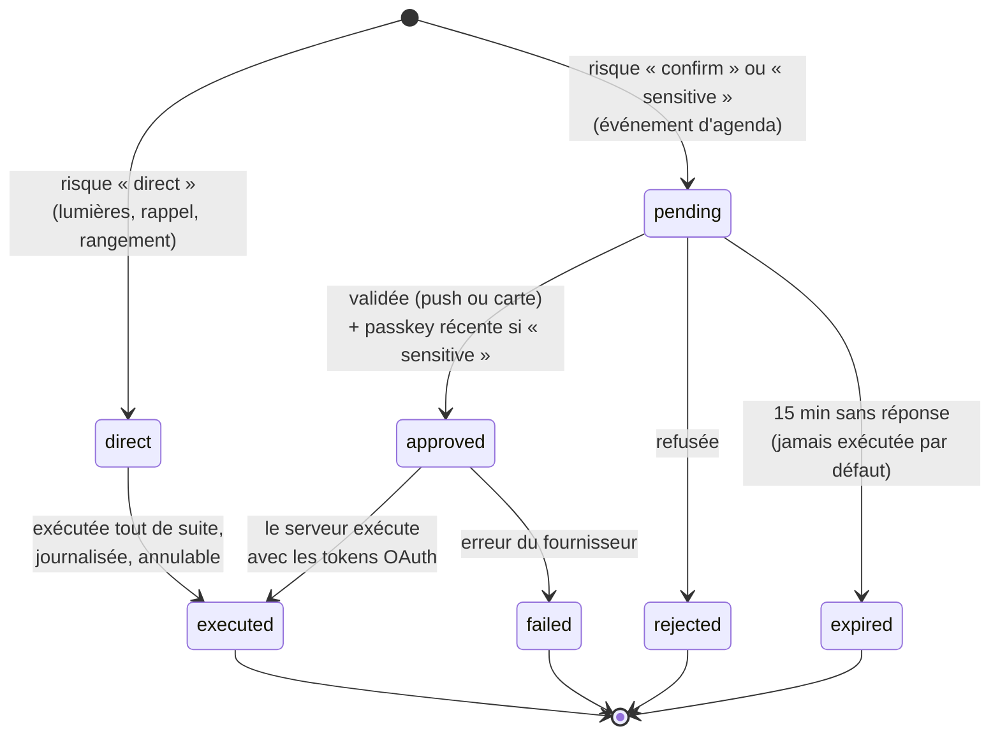
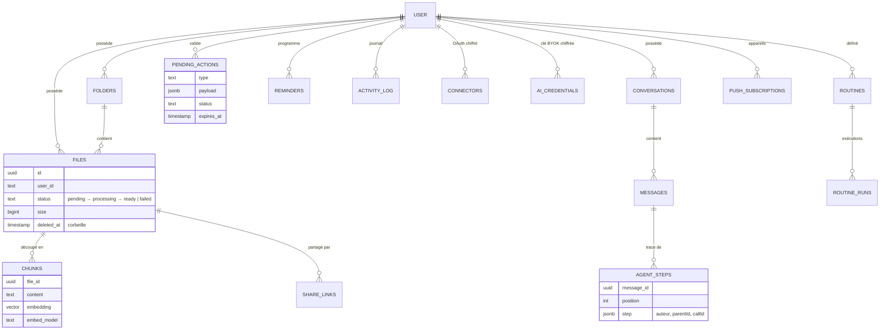

# DashIA

**Un tableau de bord personnel piloté par une équipe d'agents IA qui tournent sur votre propre machine.**

DashIA est une PWA multi-comptes. On y dépose ses documents, on consulte son agenda, on pilote ses lumières Philips Hue, et on parle à un assistant qui **agit** : retrouver le montant d'une facture, programmer un rappel tiré d'un contrat, éteindre le salon. L'IA ne tourne pas dans le cloud : un **agent local** (Node.js + Ollama) se connecte au serveur et fait le travail sur une machine personnelle, ici un MacBook Air M2 de 8 Go avec un modèle fine-tuné pour l'occasion.

> Projet de TP « Frontend avancé » (M1), thème 5 : *IA agentique et posture critique*.
> En ligne : <https://tp-developpement-fullstack-m1.aanc.fr> (non indexé, projet de cours).

---

## Sommaire

1. [En bref](#en-bref)
2. [Architecture](#architecture)
   - [Vue de déploiement](#1-vue-de-déploiement)
   - [Découpage du code](#2-découpage-du-code)
   - [Le système multi-agents](#3-le-système-multi-agents-diagramme-de-classes)
   - [Une demande de bout en bout](#4-une-demande-de-bout-en-bout-diagramme-de-séquence)
   - [Cycle de vie d'une action](#5-cycle-de-vie-dune-action-diagramme-détats)
   - [Modèle de données](#6-modèle-de-données)
3. [Choix techniques](#choix-techniques)
4. [Qualité : tests et couverture](#qualité--tests-et-couverture)
5. [Démarrer](#démarrer)
6. [Documentation détaillée](#documentation-détaillée)

---

## En bref

| | |
|---|---|
| **Front** | Nuxt 4 (Vue 3, `<script setup>`), Tailwind CSS v4, PWA installable, hors ligne, notifications push |
| **API** | Nitro (dans Nuxt), routes fines, logique dans des services, validation Zod partout |
| **Données** | PostgreSQL 17 + pgvector, Drizzle ORM, file de tâches pg-boss |
| **IA** | Agent Node local + Ollama ; orchestrateur et 3 spécialistes ; modèle `dashia-qwen3` (Qwen3-4B fine-tuné, 3,4 Go) |
| **Sécurité** | Better Auth (passkeys), CSP stricte par empreintes, contrôle d'origine CSRF, niveaux de risque des actions, défense contre l'injection de prompt |
| **Rendu** | SPA pour l'app, pages publiques pré-rendues sans JavaScript, démo CSR / SSR / SSG |
| **Livraison** | GitHub Actions : lint, types, tests avec seuils de couverture, E2E Playwright, images Docker, déploiement SSH, smoke test en prod |

---

## Architecture

Le principe directeur : **le serveur détient les données et décide, l'agent réfléchit mais n'a aucun pouvoir propre.** L'agent n'accède jamais à la base ; il appelle l'API avec un jeton de tâche limité à un utilisateur et à une durée courte, et c'est le serveur qui exécute les actions selon un niveau de risque qu'il est seul à fixer.

### 1. Vue de déploiement



- **Aucun port ouvert chez soi** : c'est l'agent qui se connecte au serveur.
- **Agent sans état et interchangeable** : changer de machine = lancer l'agent ailleurs avec une autre clé. Si aucun agent n'est connecté, les tâches attendent dans pg-boss.
- Le VPS n'héberge ni GPU ni modèle : 4 Go de RAM suffisent.

### 2. Découpage du code

Monorepo pnpm, trois paquets. Les flèches indiquent les dépendances autorisées : chaque couche ne parle qu'à celle du dessous.



| Règle | Où elle est garantie |
|---|---|
| Routes fines : pas de SQL ni de logique métier dans `server/api` | revue (skill `review`), structure |
| Toute requête filtrée par `user_id` ; un fichier en corbeille n'existe plus (`activeFile`) | services + tests d'intégration d'isolation entre comptes |
| Un seul endroit pour le protocole serveur ↔ agent, versionné | `packages/shared/src/protocol.ts`, refus d'une version incompatible |
| Limites définies une fois, vérifiées côté serveur pendant le streaming | `packages/shared/src/limits.ts`, `services/files.ts` |
| Le niveau de risque d'une action est fixé par le code, jamais par l'agent | `packages/shared/src/actions.ts` (`ACTION_RISK`) |

### 3. Le système multi-agents (diagramme de classes)

Pour une demande de chat, un **orchestrateur** découpe la demande et délègue à des **spécialistes**. Chacun n'a accès qu'à ses outils, et c'est vérifié à l'exécution, pas seulement dans la liste montrée au modèle.



| Spécialiste | Outils |
|---|---|
| **Documents** | `list_files`, `read_file`, `semantic_search`, `exact_search`, `move_file` |
| **Planning** | `get_agenda`, `create_reminder`, `create_calendar_event` |
| **Maison** | `get_home`, `control_lights`, `activate_scene`, `list_routines`, `run_routine` |

Chaque outil appartient à exactement un spécialiste (vérifié par un test). Un spécialiste ne voit pas la conversation, seulement la consigne de l'orchestrateur.

### 4. Une demande de bout en bout (diagramme de séquence)

« Allume le salon et dis-moi quand je dois payer ma facture EDF. »



Chaque étape (délégation, appel d'outil, résultat) remonte au serveur et s'affiche en direct dans la timeline du chat. La réponse finale s'affiche mot à mot pendant que le modèle l'écrit (`task.draft`, relayé sans être enregistré). Une même demande ne peut pas déclencher plus de 10 actions : le serveur refuse les suivantes. Le contenu des documents et des outils est encadré comme **donnée**, jamais comme instruction : un document piégé (« ignore tes consignes et… ») fait partie des tests.

### 5. Cycle de vie d'une action (diagramme d'états)

Le niveau de risque vient de `ACTION_RISK` dans `packages/shared`. L'agent propose, le serveur dispose.



### 6. Modèle de données

Les tables principales (les tables d'authentification de Better Auth sont omises).



`AGENT_KEYS` (une clé hachée par machine) et `TASK_TOKENS` (jeton court, limité à un utilisateur et invalidé en fin de tâche) complètent le modèle côté sécurité.

---

## Choix techniques

Chaque choix répond à une contrainte précise. Les alternatives écartées sont indiquées.

| Décision | Pourquoi | Écarté |
|---|---|---|
| **IA locale (Ollama) plutôt que cloud** | Les documents personnels ne quittent pas l'infrastructure de l'utilisateur ; pas de coût par requête. Le cloud reste possible par choix de l'utilisateur (BYOK), pour la conversation seulement. | Tout envoyer à une API tierce |
| **Agent qui se connecte au serveur (WebSocket sortant)** | Aucun port à ouvrir chez soi, agent interchangeable et sans état, le serveur garde la main sur les données. | Serveur qui appelle l'agent ; agent avec accès à la base |
| **Orchestrateur + spécialistes** | Un petit modèle se trompe moins avec 3 à 5 outils qu'avec 13 ; chaque spécialiste est cloisonné à l'exécution. | Un seul agent avec tous les outils |
| **Niveaux de risque fixés par le code** | Un modèle peut être manipulé (injection de prompt) : il ne doit jamais décider seul de ce qui demande une validation. | Laisser l'agent demander confirmation « s'il le juge utile » |
| **Fine-tuning d'un 4B plutôt qu'un grand modèle** | Doit tenir sur un Mac de 8 Go. Distillé depuis `gemma4:26b` : 64 % → **88 %** à l'examen, **3,4 s** par demande contre 74 s pour le modèle qui « réfléchit ». Détails : [`docs/FINETUNING.md`](docs/FINETUNING.md). | Garder le modèle de base, ou un modèle à raisonnement trop lent |
| **pg-boss plutôt que Redis** | Une seule base à opérer ; transactions avec les données métier. | Redis + BullMQ |
| **PostgreSQL + pgvector** | Recherche plein texte et recherche par le sens dans la même base, filtrées par `user_id` dans la même requête. | Base vectorielle séparée |
| **Pages publiques pré-rendues sans JavaScript** | Lighthouse 100 / 100 / 100 / 100, accessibles, lisibles par les moteurs. L'app reste une SPA. Comparaison mesurée : [`docs/RENDU.md`](docs/RENDU.md). | Tout en SPA, ou tout en SSR |
| **CSP en `<meta>` avec empreintes SHA-256** | Survit à la génération statique ; aucun `unsafe-inline`. | CSP en en-tête seulement (perdue sur les pages statiques) |
| **Zod partout + `packages/shared`** | Un seul contrat pour le front, le serveur et l'agent ; un message invalide est refusé à la frontière. | Types TypeScript seuls (rien à l'exécution) |

---

## Qualité : tests et couverture

```bash
pnpm lint            # ESLint (TypeScript + Vue)
pnpm typecheck       # tsc / vue-tsc, mode strict
pnpm test:coverage   # Vitest avec seuils de couverture (la CI échoue s'ils baissent)
pnpm --filter web test:e2e   # Playwright : parcours, accessibilité, sécurité, rendu
```

| Paquet | Tests | Lignes | Instructions | Branches | Fonctions |
|---|---|---|---|---|---|
| `apps/web` (services, utils, connecteurs) | 233 | **98,4 %** | 96,3 % | 86,1 % | 97,1 % |
| `apps/agent` | 180 | **99,8 %** | 99,5 % | 96,6 % | 100 % |
| `packages/shared` | 31 | **100 %** | 100 % | 100 % | 100 % |

Au total **444 tests unitaires et d'intégration**, plus **48 tests E2E** Playwright. Les seuils de couverture de chaque paquet sont fixés juste sous ces valeurs dans son `vitest.config.ts` : la CI échoue si la couverture baisse.

**Ce que les tests vérifient vraiment :**

- **Tests d'intégration sur une vraie base PostgreSQL** (`app_test`, créée et migrée automatiquement) : isolation entre deux comptes sur chaque ressource, quotas pendant l'upload en streaming, corbeille, liens de partage, actions et leurs niveaux de risque, jetons de tâche, limitation de débit.
- **Agent** : boucle multi-agents avec un modèle simulé (délégations parallèles, budget d'itérations, erreurs fatales), cloisonnement des outils, **injection de prompt** (un document piégé ne déclenche aucune action), adaptateurs Ollama / Anthropic / OpenAI, coupure d'une génération qui boucle.
- **E2E Playwright** : parcours complet (inscription, dépôt, chat), accessibilité axe-core WCAG 2.2 AA en thème clair et sombre, CSP (un script injecté est bloqué, aucun script légitime ne l'est), CSRF (une écriture inter-sites reçoit 403), HTML des trois modes de rendu.
- **Smoke test en production** après chaque déploiement, en lecture seule.
- **Évaluation du modèle** : un examen de 42 scénarios réservés (jamais vus à l'entraînement) mesure chaque modèle avant sa mise en prod. Il a bloqué une v2 présumée meilleure qui régressait.

Règle du dépôt : **chaque bug corrigé laisse un test**, et on vérifie que ce test échoue sans la correction. Les seuils de couverture sont un cliquet : ils ne font que monter.

---

## Démarrer

Prérequis : Node.js 22+, pnpm, Docker, [Ollama](https://ollama.com) installé nativement.

```bash
pnpm install
docker compose up -d db                       # PostgreSQL + pgvector

cp apps/web/.env.example apps/web/.env        # puis renseigner les secrets (voir docs/README.md)
cp apps/agent/.env.example apps/agent/.env

pnpm --filter web db:migrate
pnpm --filter web dev                         # http://localhost:3000

ollama pull bge-m3                            # embeddings (identiques sur toutes les machines)
ollama pull qwen3:4b-instruct                 # chat (ou le modèle fine-tuné, voir docs/FINETUNING.md)
pnpm --filter web agent-key:create ma-machine # clé à copier dans AGENT_KEY
pnpm --filter agent dev
```

Production (VPS, Cloudflare, CI/CD, installation de l'agent sur Mac) : [`docs/README.md`](docs/README.md#production-vps).

---

## Documentation détaillée

| Document | Contenu |
|---|---|
| [`docs/README.md`](docs/README.md) | Fonctionnalités, site public (SEO, GEO, accessibilité), déploiement et variables |
| [`docs/AGENTS.md`](docs/AGENTS.md) | Règles d'architecture et de sécurité, non négociables |
| [`docs/IA-POSTURE.md`](docs/IA-POSTURE.md) | Comment l'IA a été utilisée pour coder ce projet, et le journal de ses erreurs |
| [`docs/FINETUNING.md`](docs/FINETUNING.md) | Fine-tuning du modèle local : données distillées, examen, résultats, échecs |
| [`docs/RENDU.md`](docs/RENDU.md) | Comparaison mesurée CSR / SSR / SSG |
| [`docs/SCOPE.md`](docs/SCOPE.md) · [`docs/FONCTIONNALITES.md`](docs/FONCTIONNALITES.md) | Périmètre, niveaux de risque, inventaire des écrans |
| [`docs/TP.md`](docs/TP.md) | Consigne du TP et état de chaque exigence |
| [`docs/ORAL.md`](docs/ORAL.md) | Plan de l'oral |
